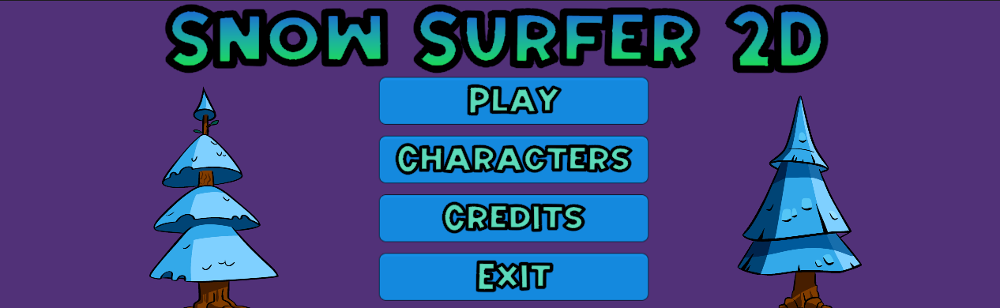
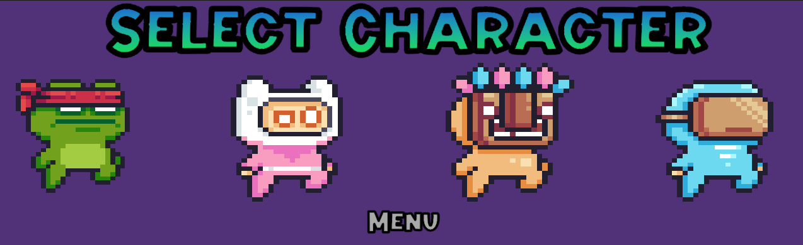
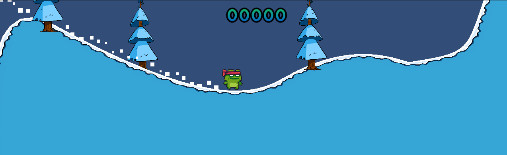
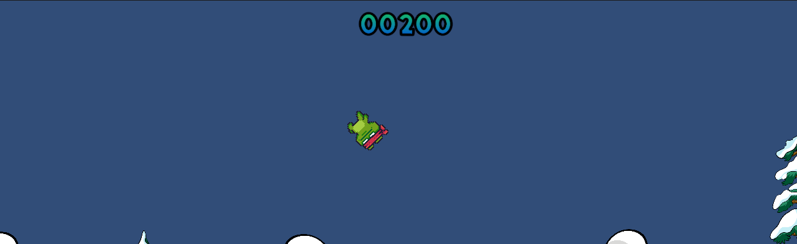
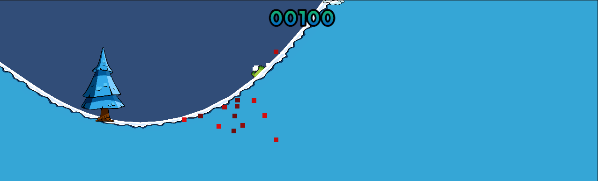

# 🏂 Snow Surfer 2D

A small 2D snowboarding arcade game developed with **Unity 6.6** and **C#**.

Slide down an icy landscape, perform aerial tricks, collect points and try to reach the finish line without crashing!

This project was developed as part of my learning journey with Unity through **PUE Academy**.

## 🎮 Gameplay

The objective is to reach the finish line, marked by a flag at the end of the iceberg, while achieving the highest score possible.

The player slides across the icy terrain, building up momentum and jumping into the air to perform rotations.

Every complete rotation earns **100 points**. However, landing incorrectly (on your side or head) results in a crash and restarts the game.

### ✨ Features

- **Snowboarding mechanics:** Run, slide across the ice and jump.
- **Aerial tricks:** Rotate your character while airborne.
- **Scoring system:** Earn 100 points for every complete rotation.
- **Crash detection:** Incorrect landings cause the player to crash and restart the game.
- **Character selection:** Choose between four playable characters.
- **Power-up:** An item that increases the character's size.
- **Particle effects:** Snow particles while moving and red particles when crashing.
- **Sound effects and music:** Different background tracks for the main menu and gameplay, alongside specific sounds for crashes and reaching the finish line.

## 🕹️ Controls

| Key | Action |
|---|---|
| `A` | Rotate counterclockwise while airborne |
| `D` | Rotate clockwise while airborne |
| `SPACE` | Jump |
| `ESC` | Open the pause menu |

## 🏠 Main Menu

The game features a main menu with four options:

- **Play:** Start the game.
- **Characters:** Select your playable character.
- **Credits:** View the game credits.
- **Exit:** Close the game.

## 📸 Screenshots

### Main Menu



### Character Selection



### Gameplay



### Aerial Tricks

Perform rotations while airborne to increase your score.



### Crash Effects

Landing incorrectly triggers a crash, accompanied by particle effects.



## 🛠️ Built With

- **[Unity 6.6](https://unity.com/)** – Game engine.
- **C#** – Programming language.
- **[Visual Studio Code](https://code.visualstudio.com/)** – Code editor.
- **Pixel Adventure 1** – Asset pack used in the project.
- **Free 2D Cartoon Parallax Background** – Additional asset pack explored during development.

## 🚀 Getting Started

### Requirements

- Unity Hub.
- Unity 6.6.
- Visual Studio Code (recommended).

### Installation

1. Clone this repository:

   ```bash
   git clone https://github.com/resakbear/PUE_SnowSurfer2D.git
   ```

2. Open Unity Hub.
3. Select **Add → Add project from disk**.
4. Browse to the cloned `PUE_SnowSurfer2D` folder.
5. Open the project using Unity 6.6.
6. Open the main scene and press Play!

## 🎓 Credits & Acknowledgements

This project was developed as part of my training at **[PUE Academy](https://campus.pue.es/)**.

The visual assets and resources used in the game were obtained from the **[Unity Asset Store](https://assetstore.unity.com/)**, including the Pixel Adventure 1 asset pack.

Special thanks to the creators of the assets used in this project.

## 📌 Project Status

This is a personal learning project developed with Unity.

The repository contains the Unity project files and resources required to open and explore the project in the Unity Editor. It does not currently include a standalone executable build.

---

*Thanks for checking out Snow Surfer 2D! 🏂❄️*
